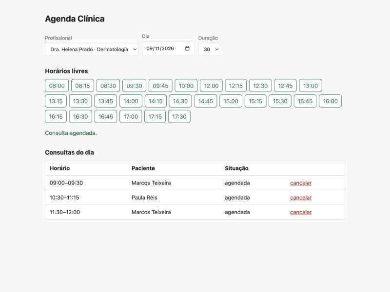

# Agenda Clínica

API de agendamento de consultas, com a parte chata que costuma dar problema em sistema de agenda: conflito de horário, expediente e remarcação.



## O que ela garante

- Um profissional não tem duas consultas sobrepostas
- Um paciente não pode estar em duas consultas ao mesmo tempo, nem com profissionais diferentes
- A consulta tem que caber inteira no expediente do profissional (horário e dias da semana)
- Não agenda no passado
- Consulta que termina às 10:00 não conflita com a que começa às 10:00
- Cancelar libera o horário; remarcar não conflita com a própria consulta
- `GET /professionals/{id}/availability` devolve os horários livres do dia, em intervalos de 15 minutos, já descontando o que está ocupado

CPF é validado pelos dígitos verificadores e o paciente é devolvido com o CPF mascarado (`***.***.247-25`). Guardar e expor CPF inteiro à toa é o tipo de coisa que dá problema com a LGPD.

## Stack

FastAPI, SQLAlchemy 2.0, Pydantic 2, SQLite. Front de demonstração em HTML e JavaScript puro, servido pela própria API.

A regra de agenda (`app/scheduling.py`) é feita de funções puras, sem banco, então os testes dela são rápidos e não precisam de setup. As rotas ficam em `app/main.py`.

## Rodando

```bash
python -m venv .venv
source .venv/bin/activate
pip install -r requirements-dev.txt

uvicorn app.main:app --reload
```

Abra http://localhost:8000 para a tela de demonstração ou http://localhost:8000/docs para a documentação gerada pelo FastAPI. O banco é criado em `./agenda.db` na primeira execução (mude com `DATABASE_URL`).

Para ter o que ver na tela, cadastre um profissional e um paciente:

```bash
curl -X POST localhost:8000/professionals -H 'content-type: application/json' \
  -d '{"name": "Dra. Helena Prado", "specialty": "Dermatologia"}'

curl -X POST localhost:8000/patients -H 'content-type: application/json' \
  -d '{"name": "Marcos Teixeira", "cpf": "529.982.247-25"}'
```

## Testes

```bash
pytest
```

São 30 testes: validação de CPF, regras de agenda e a API ponta a ponta com banco em memória. O relógio é uma dependência (`get_now`) e os testes fixam a data, então nada depende do dia em que rodam.

## Erros

Conflitos e regras de negócio devolvem `detail.code`, para o front poder tratar sem depender do texto:

| Status | code | Quando |
|--------|------|--------|
| 409 | `professional_busy` | profissional já ocupado |
| 409 | `patient_busy` | paciente já ocupado |
| 409 | `cpf_taken` | CPF já cadastrado |
| 422 | `outside_working_hours` | fora do expediente |
| 422 | `in_the_past` | horário já passou |

## Limitações

- Horários são "ingênuos", no fuso da clínica. Funciona bem para uma clínica só; para várias cidades eu guardaria em UTC com o fuso de cada unidade.
- A checagem de conflito é uma consulta seguida de insert. No SQLite, com um escritor por vez, isso é seguro. Com Postgres e muita concorrência eu usaria uma constraint de exclusão (`EXCLUDE USING gist`) para o banco garantir.
- Não tem autenticação. Qualquer cliente que alcance a API consegue agendar.
- Sem migrations (Alembic). As tabelas são criadas no startup.

## Licença

MIT
